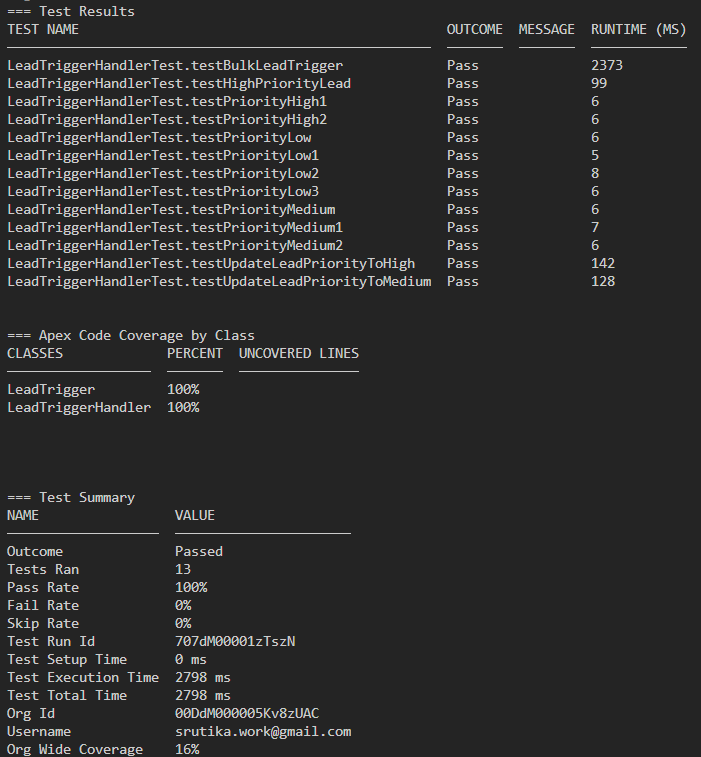

# Salesforce Developer Portfolio

Hands-on Salesforce projects built in a free Developer Edition org, each one focused on a core developer skill. Every project lives on its own branch, is merged through a pull request, and comes with tests.

| # | Project | Skills |
|---|---------|--------|
| 1 | [Lead Priority Trigger](#project-1-lead-priority-trigger) | Apex triggers, handler pattern, Apex testing |

---

## Project 1: Lead Priority Trigger

### What it does
Whenever a Lead is created or edited, a `before insert` / `before update` trigger automatically sets a custom picklist field, `Lead_Priority__c` (High / Medium / Low), based on the lead's annual revenue and industry. Sales reps no longer have to rank leads by hand.

### Business rules
Rules are evaluated top to bottom, and the first match wins:

| Priority | Condition |
|----------|-----------|
| **High** | Annual revenue is **10,000,000 or more** |
| **Medium** | Annual revenue is **1,000,000 or more**, **or** the industry is Technology or Finance |
| **Low** | Everything else, including leads with no revenue entered |

A lead with 20M revenue in Technology matches both the High and Medium rules and lands in **High**, which is why the order matters.

### How it's built
- `LeadTrigger`: contains no business logic. It checks the trigger context and delegates to the handler.
- `LeadTriggerHandler.evaluatePriority(List<Lead>)`: loops over the records in `Trigger.new` and sets the priority on each one. No DML is needed, because the trigger runs *before* the save.
- `LeadTriggerHandler.determinePriority(Lead)`: a `public static` method that takes **one** lead and returns the priority as a `String`. Keeping the rules in a small method that doesn't touch the database makes them quick to test directly.
- `Lead_Priority__c`: custom picklist field on Lead (High, Medium, Low).

### Design decisions
- **Handler pattern:** the trigger file stays tiny, and the logic lives in a class that can be tested on its own. I first wrote everything inside the trigger, then refactored, to see why the pattern exists.
- **Single-lead method:** splitting out `determinePriority` meant boundary cases could be tested with in-memory leads and no inserts. Those tests run in a few milliseconds each, versus about a second for a test that inserts.
- **Null-safe comparisons:** a blank `AnnualRevenue` is checked for `null` before it is compared, so leads with no revenue fall through to Low instead of causing surprises.
- **Apex instead of a formula field:** this rule could be a formula field, and for a pure calculation like this one that would be the declarative-first choice. I implemented it in Apex deliberately, to practice trigger mechanics (before-trigger field updates, bulk-safe loops, handler structure, testing). In a production org, I would weigh the two options.

### Testing
13 tests in `LeadTriggerHandlerTest`, with **100% coverage** on both `LeadTrigger` and `LeadTriggerHandler`.

- **Rule tests (direct calls, no DML):** High, Medium and Low outcomes; both revenue boundaries (exactly 10,000,000 → High, exactly 1,000,000 → Medium, 999,999 → Low); Finance and Technology each on their own with low revenue; precedence of High over Medium; blank revenue; zero revenue; blank revenue and blank industry together.
- **Integration test:** inserts a real lead to prove the trigger is wired up.
- **Update tests:** a lead moves from Low to High when revenue increases, and from High to Medium when revenue drops and the industry changes to Finance.
- **Bulk test:** inserts 200 leads in one DML statement and asserts the count and the exact priority of every lead.

**Mutation checks.** To confirm the tests would actually catch bugs, I deliberately broke the handler and re-ran the suite:
- Changing `>=` to `>` on the 10,000,000 rule and on the 1,000,000 rule was caught by the boundary tests.
- A typo in `'Finance'` was caught.
- A typo in `'Technology'` was **not** caught, even with 100% coverage, because no test depended on that value. I added a Technology test, repeated the mutation, and it failed as it should. Coverage tells you which lines ran, and only assertions tell you whether they're right.



### How to run
Prerequisites: [Salesforce CLI](https://developer.salesforce.com/tools/salesforcecli), a Developer Edition org, and the org authorized with `sf org login web`.

```bash
# Deploy
sf project deploy start --source-dir force-app

# Run the tests with coverage
sf apex run test --class-names LeadTriggerHandlerTest --result-format human --code-coverage --wait 10
```

### Known limitations and possible next steps
- **Manual edits are overwritten.** The trigger recalculates priority on every insert and update, so a value a user sets by hand is replaced on the next save. This isn't covered by a test yet. Options: make the field read-only on the page layout, or recalculate only when revenue or industry changes (comparing against `Trigger.oldMap`).
- **Duplicate-email blocking** (a natural extension of this trigger) is not implemented yet.